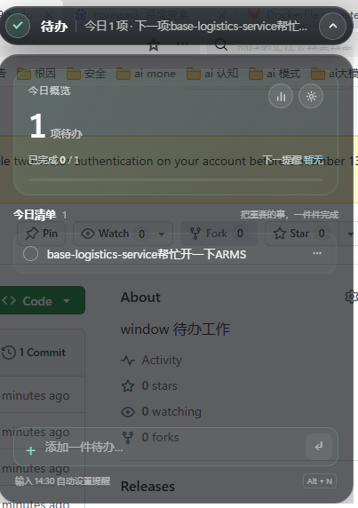
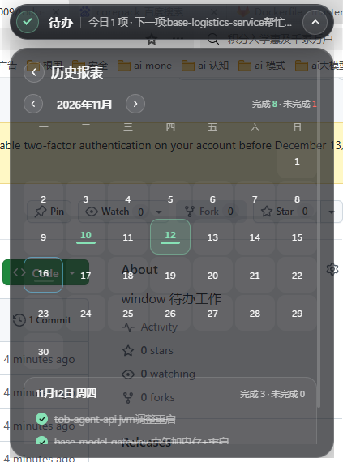

# weldd · Windows Todo 灵动岛

一个面向 Windows 10/11 的桌面待办应用，将今日任务、定时提醒和历史报表放进桌面顶部的灵动岛。当前版本：**0.1.0**。

## 界面预览

| 今日清单 | 历史报表 |
| --- | --- |
|  |  |

## 功能

- **桌面灵动岛**：透明、无边框、置顶胶囊，折叠时显示今日任务数量与下一项待办。
- **今日清单**：展开查看今日概览，添加、编辑和完成待办；未完成的过期任务自动移到今天。
- **定时提醒**：为任务设置提醒时间，在桌面接收提醒。
- **历史报表**：通过月历查看每日完成与未完成任务，回顾历史记录。
- **贴边停靠**：拖动到屏幕边缘可收起为把手，支持在设置中关闭顶部停靠。
- **本地存储**：任务保存在本机 SQLite 数据库中，支持调整界面透明度。

## 下载安装包

1. 打开 [Windows 自动打包](https://github.com/gooddayday009/todo-list/actions/workflows/build-windows.yml)。
2. 进入最近一次成功的运行，在页面底部 **Artifacts** 下载 `weldd-0.1.0-windows-x64`（需要登录 GitHub）。
3. 解压后运行 `weldd_0.1.0_x64-setup.exe`。

工作流在推送到 `main`、推送 `v*` 标签或手动点击 **Run workflow** 时执行，生成 Windows x64 NSIS 安装包。产物保留 30 天，后续版本号随应用配置更新；标签必须与应用版本一致，例如 `v0.1.0`。

## 本地开发与构建

准备 Node.js 22、pnpm 11、Rust MSVC 工具链，以及包含“使用 C++ 的桌面开发”组件的 Visual Studio 2022 / Build Tools。

```powershell
cd weldd
pnpm install --frozen-lockfile
pnpm tauri dev
```

生成安装包：

```powershell
cd weldd
.\build-release.bat
```

安装包输出目录：`weldd/src-tauri/target/release/bundle/nsis/`。构建脚本自动查找 Visual Studio 并加载 MSVC 环境。

## 项目结构

- `weldd/src/`：React + TypeScript 前端。
- `weldd/src-tauri/`：Tauri + Rust 桌面端与 SQLite 数据存储。
- `.github/workflows/build-windows.yml`：Windows 自动打包工作流。
- [设计文档](docs/DESIGN.md)、[通知说明](docs/NOTIFICATIONS.md)、[开发约定](AGENTS.md)。

任务数据位于 `%APPDATA%/com.weldd.app/weldd.db`。当前版本不包含专注计时、倒计时或云同步。
